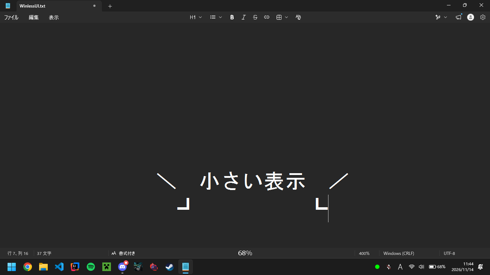

# WinlessUI
バッテリーを常に最前列で表示します。

ゲーム中の不意なバッテリー切れを防ぐために作成されました。

---

このソフトはWindows向けに作成してます。 
バックグラウンドで処理されます。 
終了するにはシステムトレイから「システムを終了」を選択してください。  
起動時に実行したい場合は Win+R -> shell:startup にファイルを導入してください。 

---

### v1.2 - v1.2.1
> - メニューを実装
> - 効果音を追加
> - 表示位置が変更可能になった
> - 表示できる項目を追加
### v1.1
- タイマー機能実装
> - システムトレイから有効化するとバッテリーの横にタイマーが表示される
> - 右シフトでタイマーをリセット
### 今後の予定
- コンフィグ機能を実装
