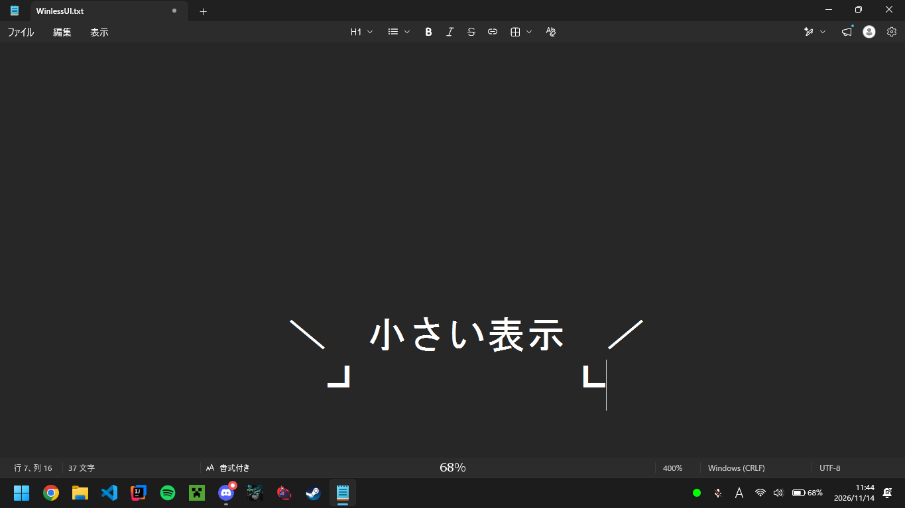

# WinlessUI
バッテリーを常に最前列で表示します。

ゲーム中の不意なバッテリー切れを防ぐために作成されました。

---

このソフトはWindows向けに作成してます。 
バックグラウンドで処理されます、 
終了するにはシステムトレイから「システムを終了」を選択してください。  
起動時に実行したい場合は Win+R -> shell:startup にファイルを導入してください。 

---

### v1.1
- タイマー機能実装
> - システムトレイから有効化するとバッテリーの横にタイマーが表示されます。
> - 右シフトでタイマーをリセットします。
### 今後の予定
- コンフィグ機能を実装